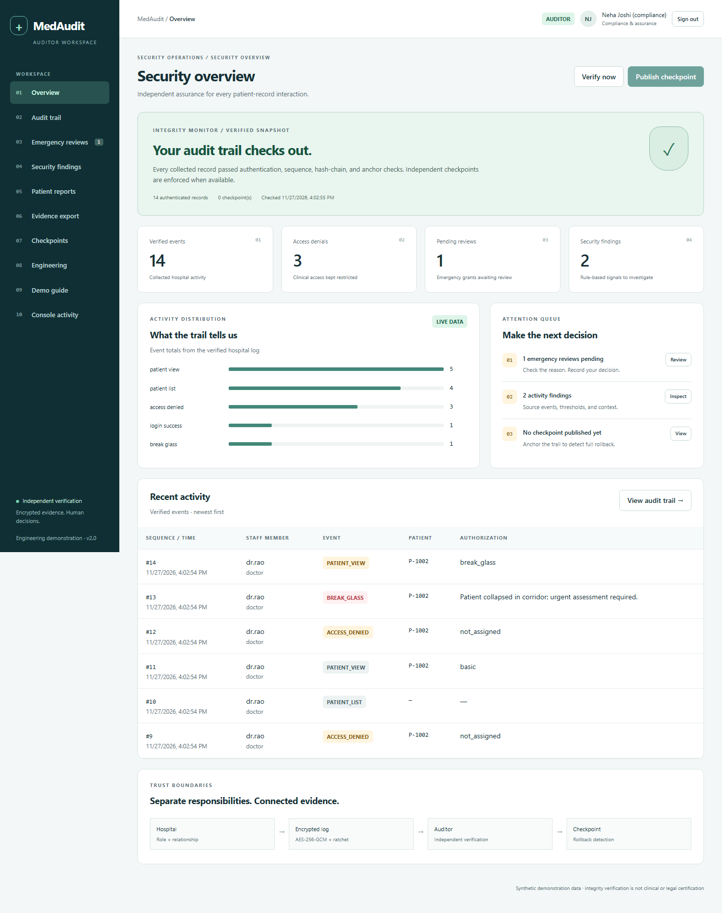

# MedAudit: tamper-evident audit logging for a hospital records system

A working two-service system that applies the **forward-secure, encrypted, tamper-evident logging**
technique (AES-256-GCM per-record keys, one-way key ratchet, SHA-256 hash chain, authenticated anchor,
off-host checkpoints, Zero Trust access control) to a realistic problem: **who accessed which patient's
record, and can we prove nobody altered that history?**

| Service | Port | Role |
|---|---|---|
| **Hospital app** (`medaudit/hospital`) | 8000 | Staff sign in, search patients, read/update records. Every request is authenticated, authorised and **audited before data is released**. Holds *no* root key. |
| **Auditor console** (`medaudit/auditor`) | 8001 | Holds the root key. Verifies the trail, decrypts it, raises tamper alerts, publishes checkpoints, produces compliance reports. Its own activity is also logged. |

They are separate processes with separate data directories, as they would be on separate machines in production.


## Version 2 demonstration workspace



The redesigned hospital and auditor interfaces share an accessible, responsive
clinical workspace. New features complete the investigation workflow:

- **Emergency reviews:** append a reviewed/flagged disposition, explanation,
  reviewer, and revision to the verified encrypted console history.
- **Security findings:** explain repeated denied access, failed sign-ins, and
  emergency grants with source sequence numbers and documented thresholds.
- **Evidence export:** verified patient/user/event-filtered JSON and CSV with
  snapshot metadata, checkpoint references, an audited download, and CSV formula
  protection.
- **Engineering assurance:** inspect requirements, STRIDE threats, architecture,
  and test references; simulate the real role/relationship authorization policy
  without changing account access.
- **Guided demonstration:** follow the complete access-to-evidence story and run
  an isolated tampering/rollback lab with `python scripts/demo_lab.py`.
- **Native Windows safety:** protected NTFS DACLs and process file locks, alongside
  the existing POSIX implementation. Use **Python 3.12** for the documented setup.

Local verification: **73 tests passed**, **92% statement coverage** on Windows,
no known advisories in the locked runtime dependency scan, and a completed desktop
and mobile browser rehearsal. These are measured local results, not a claim of
production security or complete standards compliance. See
[verification evidence](docs/verification.json), [engineering methods](docs/ENGINEERING.md),
and [the presentation walkthrough](docs/DEMO.md).

Generated keys, databases, and audit state are no longer tracked. **Keys in old
Git history remain public.** Use a fresh installation; do not reuse the original
bundled data. In an existing old clone, choose a new private directory, for
example `python run.py --demo --data data-v2` (add it to your local Git ignore).

## Quick start

```bash
python -m pip install --require-hashes --only-binary=:all: -r requirements.lock
python run.py --demo            # creates ./data with demo accounts, starts both services
```

Open <http://127.0.0.1:8000> (hospital) and <http://127.0.0.1:8001> (auditor).

| Demo account | Password | Role |
|---|---|---|
| `dr.rao` | `Doctor#Pass2026` | doctor, assigned to P-1001, P-1003, P-1005 |
| `dr.sen` | `Doctor#Pass2027` | doctor, assigned to P-1002, P-1004, P-1006 |
| `nurse.mehta` | `Nurse#Pass2026` | nurse, assigned to P-1001, P-1002 |
| `recep.iyer` | `Recept#Pass2026` | front desk, demographics only |
| `admin1` | `Admin#Pass2026` | IT admin, manages accounts, **no** patient data access |
| `auditor1` | `Auditor#Pass2026` | auditor console |

All patients are synthetic. For anything other than a demo, run `python scripts/init_system.py` instead:
it generates random passwords and prints them once.

### Five-minute demo script

1. **Hospital:** sign in as `dr.rao`, open *Aarav Sharma* (assigned: full record). Go back and open *Diya Nair*
   (not assigned: record hidden, denial logged). Enter a reason and press **Break glass**: access is granted and flagged.
2. **Auditor:** sign in as `auditor1`. Banner is green. Open **Patient access report → P-1002** to see the denial, the break-glass
   grant with the stated reason and the flagged view. Press **Publish checkpoint**.
3. **Attack the host** (simulating an intruder with disk access) and press **Verify now** each time:
   ```bash
   python scripts/attack_demo.py flip 3        # edit ciphertext -> "authentication tag mismatch", record 3
   python scripts/attack_demo.py undo
   python scripts/attack_demo.py truncate 3    # silently cut the tail -> "log truncated"
   python scripts/attack_demo.py undo
   python scripts/attack_demo.py delete 2      # remove a record -> sequence mismatch
   python scripts/attack_demo.py undo
   ```
   The banner turns red, the log contents are **withheld**, an alert is recorded, and further checkpoints are refused.
4. **Whole-host rollback** (the hardest case): `attack_demo.py backup`, generate more activity, publish a checkpoint,
   then `attack_demo.py rollback`. The restored host is internally consistent, but the off-host checkpoint exposes it.

## What is protected, and how

```
 LOGGING HOST  data/hospital/                       AUDITOR SIDE  data/auditor/
 ------------------------------------------         -------------------------------------
 hospital.db     patients, users, sessions          root.keys        root key(s)    [0600]
 audit/audit.log   encrypted records                checkpoints.jsonl  published (seq:hash)
 audit/state.key   CURRENT chain key only           alerts.jsonl     tamper alerts
 audit/anchor.mac  authenticated head anchor        console_audit/   auditor-activity log
```

**Record format** (one line): `SL1|seq|time|severity|actor|key_id|iv|ciphertext|tag|prev_hash`

* The event JSON is encrypted with **AES-256-GCM** under a **per-record key**. Time, severity, actor and key id stay readable
  but are bound as AAD, so editing them breaks the tag.
* `prev_hash` chains every record to the SHA-256 of the previous line: deletion, reordering and duplication are detected.
* **Forward security:** `CK[i+1] = HMAC(CK[i], "next")`; the host keeps only the current `CK`, overwriting it after every
  record, and never holds the root key. An attacker who takes over the host later cannot decrypt or re-forge earlier records.
* **Truncation:** after each record the host stores `(seq, hash, MAC)` keyed from that record's chain key. Cutting records off
  the tail, or deleting the anchor, fails verification. **Checkpoints** (kept by the auditor) additionally catch a full rollback.
* **Crash safety:** state files are written atomically (temp + fsync + rename); an interrupted append self-heals.
* **Verification** takes a shared lock, so the auditor never sees a half-written record (no false alarms while the hospital is logging).

### Zero Trust in the hospital app

| Principle | Implementation |
|---|---|
| Never trust, always verify | Bearer session on every call; browser credentials stay in memory; idle (15 min) + absolute (8 h) expiry; disabling a user kills their sessions; only the SHA-256 of tokens is stored |
| Least privilege | Roles + **care relationship**: nurses/doctors see clinical data only for *assigned* patients; admins manage accounts but see **no** patient data; receptionists see demographics only |
| Deny by default | Unknown role/permission is refused (`rbac.decide`); denials are logged |
| Break-glass | Emergency access needs a stated reason, is time-limited (30 min), scoped to one patient, logged as `CRITICAL`, and shown in the auditor's break-glass report |
| **Audit first, fail closed** | The audit record is written *before* data is returned or changed. If the audit log is unavailable the request gets `503` and no PHI is served |
| Minimise data in logs | Only patient IDs are logged, never names, diagnoses or search text |
| Credential safety | PBKDF2-HMAC-SHA256 (310k), constant-work login for unknown users, generic errors, lockout after 5 failures, password policy |
| Hardening | Strict input validation, security headers (CSP, nosniff, frame-deny, no-store), no API docs endpoints |

### Auditor console reports

Status banner (verified / tampering), audit trail with filters, **patient access report** (accounting of disclosures),
break-glass review, tamper alerts, checkpoints, and the **console's own activity log** (who looked at the audit trail).

## Repeatable checks

```bash
python -m pip install --require-hashes --only-binary=:all: -r requirements-dev.lock
python -m ruff check medaudit tests scripts
python scripts/demo_lab.py
python -m playwright install chromium
python scripts/browser_check.py
```

The browser check starts disposable services on ports 18000/18001 and writes
screenshots to `docs/screenshots/`. It does not reset your running dataset.
GitHub Actions checks Windows and Linux; read the actual run for remote status.

## Tests

```bash
python -m pip install --require-hashes --only-binary=:all: -r requirements-dev.lock
python -m pytest tests -q --cov=medaudit   # see docs/verification.json for measured results
```

* `test_auditlog.py`: confidentiality, ciphertext/tag/metadata tampering, delete/reorder/replay, tail truncation (with and
  without anchor deletion), forged/swapped anchors, rollback vs checkpoints, **forward security**, rotation, crash recovery,
  key-file permissions, IV uniqueness, concurrent writers.
* `test_hospital.py`: RBAC matrix, break-glass (incl. expiry and scope), lockout, session expiry, no PHI in logs,
  **fail-closed behaviour**, admin cannot read patient data, input validation.
* `test_auditor.py`: end-to-end with both apps: tamper blocks release and raises one alert, truncation, rollback via
  checkpoint, **no false alarms under concurrent logging**, console log is itself tamper-evident.

## Operations

```bash
python scripts/verify_offline.py [--expect SEQ:HASH]   # cron on the auditor machine; exit 0 ok / 6 tamper / 7 key error
python scripts/rotate_key.py                           # new root-key epoch (old records stay verifiable)
MEDAUDIT_CHECKPOINT_INTERVAL=300 uvicorn medaudit.auditor.app:create --factory --port 8001   # auto verify + checkpoint
```

## Standards mapping (supports, does not certify)

| Requirement | Where |
|---|---|
| HIPAA §164.312(b) audit controls | every access recorded with user, role, patient, time, IP, outcome |
| HIPAA §164.312(c) integrity | AES-GCM tags, hash chain, anchor, checkpoints |
| HIPAA §164.312(a)/(d) access control, authentication | RBAC + assignment, sessions, lockout, break-glass |
| HIPAA §164.308(a)(1)(ii)(D) activity review | auditor console, reports, alerts |
| HIPAA §164.528 accounting of disclosures | patient access report |
| India DPDP Act 2023, "reasonable security safeguards" | access control, logging, breach-detection evidence |

This is an engineering reference, not legal advice or a compliance certification. Check requirements with your compliance team.

## Production hardening checklist (not done here)

* **Put the two services on different machines/accounts.** Keep the root key in an HSM/KMS or on auditor-only media.
* **Ship checkpoints off-host** (WORM bucket, SIEM, email) and verify against them. The built-in store is on the auditor side only.
* Serve both apps behind **TLS** (reverse proxy); add rate limiting there (unauthenticated failed logins are logged and could be flooded).
* Replace SQLite with a managed database; **encrypt PHI at rest** (disk or field level). Only the audit log is encrypted here.
* Add **MFA** and SSO for staff; persist auditor sessions; evaluate secure HttpOnly cookies with CSRF protection for a production browser session design.
* Run `chattr +a` on `audit.log` and monitor `state.key` permissions.

## Known limitations

* **Compromise window:** forward security protects records written *before* a host compromise. An attacker holding the live
  chain key can forge records from that point on until the next checkpoint covers them, so publish checkpoints frequently.
* **Rollback needs an external anchor:** without checkpoints, restoring an old consistent backup is undetectable by design.
* **Python cannot reliably wipe memory:** the current chain key may linger in process memory. Past keys are gone from disk.
* **Verification cost:** the auditor rescans the whole log on change (cached otherwise). Use segment files + periodic checkpoints for very large logs.
* Not a certified medical system. Demo data is synthetic; demo passwords are documented and must not be used for real.

## Layout

```
medaudit/auditlog/   engine: AuditWriter, AuditVerifier, checkpoints, key ring
medaudit/hospital/   FastAPI app, RBAC rules, SQLite layer, web UI
medaudit/auditor/    FastAPI console and web UI
medaudit/setup.py    one-time initialisation (keys, accounts, synthetic patients)
scripts/             init_system, attack_demo, rotate_key, verify_offline
tests/               engine, API, workflow, and platform security regressions
run.py               starts both services as separate processes
```
