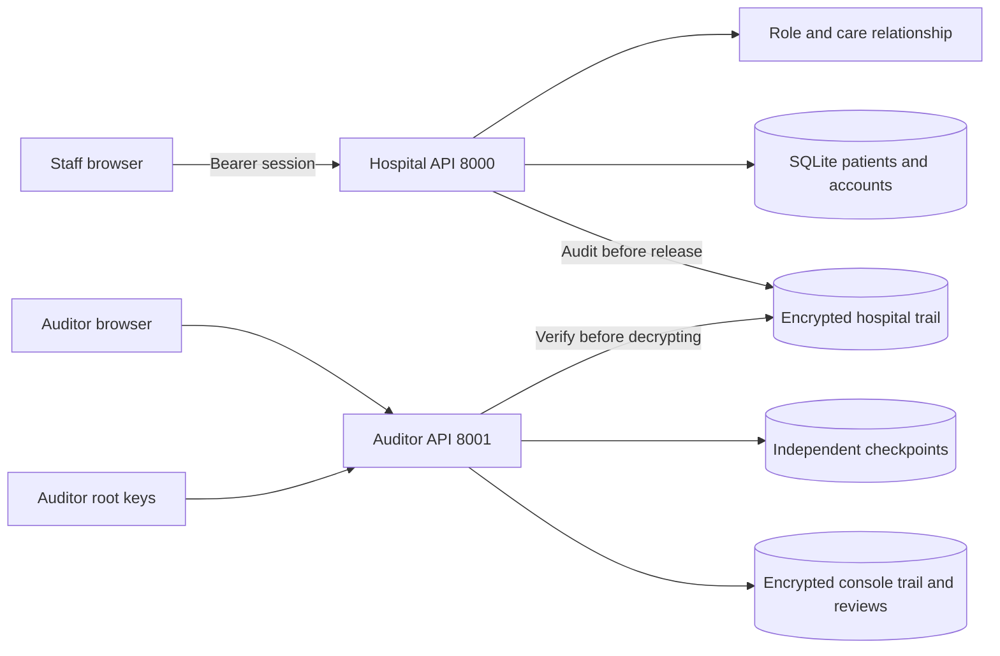
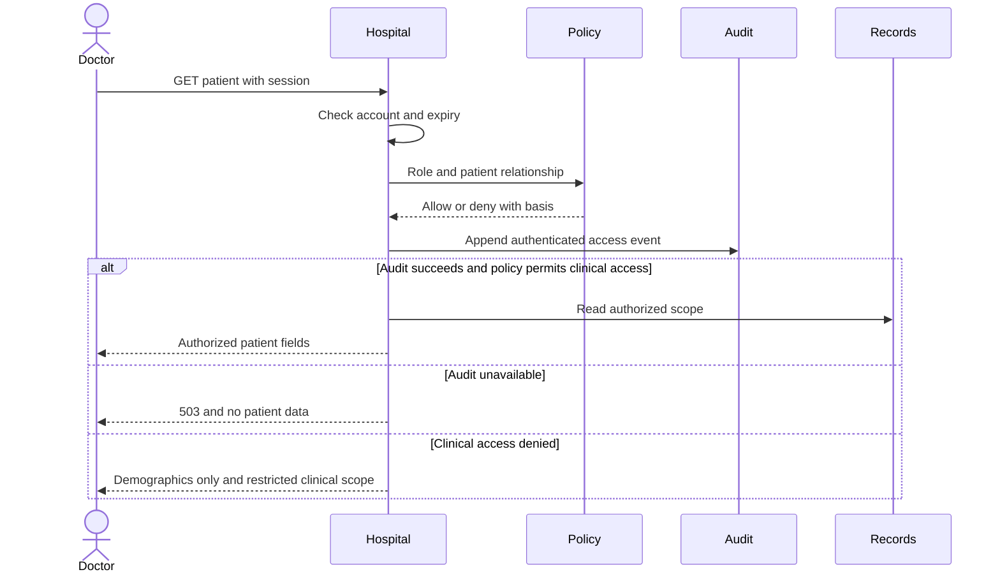
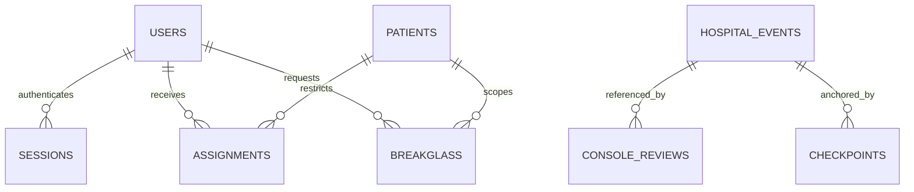

# MedAudit engineering assurance

## Scope and development method

MedAudit is an educational hospital-access and audit-assurance system. All sample
patients are synthetic. Its central question is whether patient-record access is
authorized and whether the access history remains trustworthy after modification
of the logging host. It is not a complete electronic health-record system.

We use an iterative, risk-driven secure SDLC. Each increment identifies a user
story, its misuse case, an acceptance test, an implementation, and the evidence
needed to demonstrate it. The dependency order is foundation → emergency review
→ monitoring → evidence export → interface and demonstration → final assurance.
The November 2026 upgrade preserves the original encrypted log format.

The implementation follows separation of concerns: the hospital makes clinical
access decisions; the auditor verifies history and records reviews. The logging
engine does not depend on either web application. Analysis functions do not
change authorization or record contents. The project uses Git for change
management, regression tests for verification, a browser rehearsal for validation,
and GitHub Actions for repeatable checks.

## Requirements specification

Actors are a doctor, nurse, receptionist, IT administrator, and independent
auditor. The logging host and the auditor's key store are separate trust domains.
The developer/operator initializes keys and can run an isolated attack experiment.

The executable requirement catalogue lives in
[`medaudit/auditor/engineering.json`](../medaudit/auditor/engineering.json). The
Engineering screen displays the same requirement IDs, controls, threats, and test
references, avoiding a separate hard-coded UI catalogue.

| ID | Acceptance condition |
|---|---|
| SEC-01 | Missing, invalid, or expired sessions cannot read protected records or evidence. |
| SEC-02 | Role and patient relationship both participate in clinical access decisions; IT administrators cannot read clinical records. |
| SEC-03 | Modified ciphertext, changed metadata, deleted/reordered records, truncated tails, and checkpoint-conflicting rollback are detected. |
| SEC-04 | Failed hospital verification blocks new review, findings, and evidence-export paths. |
| SEC-05 | Emergency reasons are trimmed and validated before creating time-limited, patient-scoped grants. |
| FR-06 | Auditors append a review or flagged disposition with identity and explanation; stale revisions are rejected and reviews survive restart. |
| FR-07 | Threshold findings contain the rule, window, actor, explanation, and supporting sequence numbers. |
| FR-08 | Auditors export filtered verified snapshots; exports are audited and CSV formulas are neutralized. |
| SEC-09 | Registration rejects blank normalized names, impossible/future dates, and unexpected fields. |
| SEC-10 | New installations generate fresh keys; generated keys, databases, and bytecode are absent from the current tracked tree. |

Nonfunctional requirements include fail-closed operation, audit confidentiality
and integrity, least privilege, understandable UI status, responsive layout,
reproducible Python dependencies, and documented operational limits. Native
Windows uses NTFS DACLs and `LockFileEx`; POSIX uses file modes and `flock`.
Production throughput and response-time service levels have not been established.

Emergent properties arise from combinations of components. Accountability needs
identity, authorization, durable logging, independent verification, and review
together. Rollback detection needs an external checkpoint; an internally
consistent old snapshot cannot reveal its own age. Availability and privacy can
conflict with evidence collection, so failures withhold data rather than bypass
auditing. Forward security protects past record keys on the logging host, but
does not protect records created after compromise of its current chain key.

## Architecture and models

The local demonstration shares a computer and directory tree. Separate
processes are an architectural boundary, not a claim of physical host isolation.
The hospital root key belongs only to the auditor side. Production must enforce
this with service accounts or separate hosts.

The concrete handler may read the SQLite row before recording the event, but it
does not release patient data until the audit succeeds. Clinical updates audit
before the database mutation. A recorded update is therefore an intent event,
not proof that a later database commit succeeded.

Console reviews are encrypted log events, not mutable database rows. Each review
references both a hospital grant sequence and a digest of the full grant event.
The displayed state is a projection of verified console events. This prevents a
different grant from inheriting a review solely because it reuses a sequence.
Revision checks prevent two browser submissions from silently overwriting one
another in the supported single-process auditor deployment.

## Threat model and risk register

| STRIDE | Abuse case | Control | Residual risk |
|---|---|---|---|
| Spoofing | Guess a password or reuse an old token | Password hashing, random sessions, expiry, lockout | MFA and SSO deferred |
| Tampering | Edit ciphertext or restore an old disk image | GCM, sequence/hash chain, head MAC, external checkpoints | Current chain-key compromise affects future records |
| Repudiation | Deny emergency access or silently rewrite its review | Authenticated grants and immutable review history | A reason can still be dishonest |
| Information disclosure | Read log files, root keys, or export PHI | Encryption, key ownership, field minimization, export authorization | Exported files need secure retention |
| Denial of service | Flood sign-ins or exhaust disk space | Account lockout, findings, fail-closed behavior | Reverse-proxy limits and quotas still required |
| Elevation of privilege | Read another doctor's clinical record or use admin access for PHI | Server-side role and relationship checks | Authorized caregivers can misuse legitimate access |

Priority risks are public historical keys (high impact; retire those keys),
same-host demo isolation (high impact; separate service accounts in deployment),
and audit unavailability (high impact; monitor storage and exercise recovery).
Rule findings intentionally avoid an unvalidated numerical risk score. The risk
register is engineering analysis, not a legal or compliance certification.

## Architectural decisions

### ADR 001 Preserve the two service design

The hospital can append evidence without possessing the root keys required to
decrypt history. The auditor independently verifies and reports. This is useful
only when deployment enforces the intended key and filesystem boundaries.

### ADR 002 Store reviews in the existing console trail

An independent mutable review table would need a second integrity mechanism.
Appending review events reuses encryption, sequence integrity, and attribution.
The tradeoff is scan/projection cost as history grows. Segmenting and indexing
verified history is a future scalability step.

### ADR 003 Use deterministic monitoring rules

Five failed sign-ins or three access denials for an actor in fifteen minutes
raise a finding. Every emergency grant produces a review reminder. These rules
are reproducible and explainable with a small synthetic dataset. They cannot
establish malicious intent. Emergency reminders remain historical findings even
after the separate review workflow records a disposition.

### ADR 004 Keep browser credentials in memory

The redesigned UIs no longer persist session tokens in Web Storage. Reloading
requires signing in again. Same-origin external scripts permit a stricter script
CSP. This reduces persistent credential exposure but does not eliminate XSS;
output escaping and server-side authorization remain essential.

### ADR 005 Support native Windows explicitly

The original Unix-only locking prevented the class demonstration from running
natively on Windows. A platform helper now implements Windows file locks,
protected DACLs, binary I/O, and write-through replacement while retaining the
POSIX behavior. Tests exercise real ACL rejection and concurrent writers. An
ordinary Windows `chmod` test is insufficient to establish DACL security.

## Test strategy and traceability

The original engine, hospital, and auditor tests remain. New integration tests
cover authorization on every added route, durable/stale reviews, rule evidence,
filtered export, CSV formula prefixes, tampered logs, console-audit failure,
policy simulation, and normalized validation.

`scripts/browser_check.py` initializes disposable synthetic data, starts both
services on ports 18000/18001, rehearses the main workflows, exercises all
navigation, downloads a real report, checks a mobile viewport, and rejects
uncaught browser errors. It does not use the running demonstration's dataset.
`scripts/demo_lab.py` demonstrates ciphertext tampering and whole-host rollback
in a separate temporary directory.

The current local verification evidence is recorded in
[`verification.json`](verification.json). The requirement catalogue links test
names rather than displaying invented live pass/fail badges. CI repeats tests on
Windows and Linux and runs the browser flow on Linux. Remote CI status must be
read from the actual workflow run; configuring it is not evidence it has passed.

## Limitations and future work

- SQLite patient records are not encrypted at rest; only audit payloads are.
- Login throttling is account-based; a reverse proxy must address distributed
  failures, unknown-account floods, storage exhaustion, and network-layer limits.
- Auditor sessions and review coordination are process-local. Run one auditor
  worker until sessions, coordination, and failure counters use a shared store.
- Full-history scans and in-memory export generation suit a demonstration, not
  an unbounded production archive. Add verified segments and bounded streaming.
- Python does not guarantee reliable erasure of old key material from memory.
- The local checkpoint store must be retained independently in production.
- Previous root keys were published in upstream Git history. This change removes
  generated state from the current tree; it does not erase history.
- A dependency advisory scan only detects known published vulnerabilities.
- The browser test covers critical paths; it is not a complete accessibility or
  penetration-testing certification.

## References

- [Python file locking availability](https://docs.python.org/3/library/fcntl.html)
- [FastAPI application structure](https://fastapi.tiangolo.com/tutorial/bigger-applications/)
- [Pydantic validators](https://docs.pydantic.dev/latest/concepts/validators/)
- [OWASP ASVS](https://asvs.owasp.org/)
- [OWASP CSV injection](https://owasp.org/www-community/attacks/CSV_Injection)
- [Microsoft LockFileEx](https://learn.microsoft.com/en-us/windows/win32/api/fileapi/nf-fileapi-lockfileex)
- [Cryptography AESGCM](https://cryptography.io/en/latest/hazmat/primitives/aead/)
